# 📱 Awesome SMS Marketing & Text Messaging 💬

**A curated index of top-tier SaaS platforms and self-hosted open-source software for SMS marketing, text message campaigns, bulk messaging, OTP delivery, CPaaS routing, and Android-based SMS gateways.**

*Last updated: October 2026*

---

## 📌 Table of Contents

- [🌐 Sector Overview & Market Dynamics](#-sector-overview--market-dynamics)
- [🏢 SaaS & Hosted Commercial Platforms](#-saas--hosted-commercial-platforms)
- [💻 Open-Source GitHub Projects](#-open-source-github-projects)
  - [⭐ Featured Open-Source SMS Gateways & Utilities](#-featured-open-source-sms-gateways--utilities)
  - [🛠️ CPaaS, Delivery & Campaign Frameworks](#️-cpaas-delivery--campaign-frameworks)
- [⚖️ SaaS vs. Self-Hosted: Architecture & Caveats](#️-saas-vs-self-hosted-architecture--caveats)
- [🤝 How to Contribute](#-how-to-contribute)
- [💖 Support & Sponsorship](#-support--sponsorship)
- [📈 Star History](#-star-history)
- [📄 Disclaimer](#-disclaimer)

---

## 🌐 Sector Overview & Market Dynamics

The global SMS marketing and enterprise messaging software market is valued at approximately **$14.4 billion to $16.0 billion in 2025–2026**, with projections surpassing **$36 billion by the early 2030s** expanding at a compound annual growth rate (CAGR) of 14% to 20%.

The sector exhibits a **bifurcated competitive structure: moderately fragmented at the application and SaaS marketing software layer**, where hundreds of direct-to-consumer (DTC), e-commerce, and local business marketing platforms (such as Klaviyo, Attentive, Postscript, and SimpleTexting) compete intensely; but **highly concentrated at the underlying telecom infrastructure and CPaaS layer**, where tier-1 aggregators and carrier gateways (such as Twilio and Sinch) command dominant market share and control direct carrier relationships, 10DLC trust hub registries, and shortcode provisioning.

---

## 🏢 SaaS & Hosted Commercial Platforms

The table below catalogs leading commercial SMS marketing platforms, sorted in descending order by company scale (enterprise market capitalization or private equity / venture valuation):

| Platform | Company Scale (Valuation / Market Cap) | Key Capabilities | Starting Paid Tier Pricing | Free Tier / Free Trial Limits |
| :--- | :--- | :--- | :--- | :--- |
| **[Twilio](https://www.twilio.com/)** | ~$31.5B–$37.5B Market Cap *(NYSE: TWLO)* | Global CPaaS developer APIs, Programmable Messaging REST APIs, multi-carrier fallback, OTP/verify services, and phone number provisioning. | **$0.0079/SMS** *(US pay-as-you-go baseline + carrier fees; local numbers at $1.15/mo)* | **30-Day Free Trial** (Includes product-specific test balance: 100 SMS messages, 100 WhatsApp messages, and 3,000 SendGrid emails; expires after 30 days without upgrade) |
| **[HubSpot SMS Marketing](https://www.hubspot.com/)** | ~$12.5B–$13.9B Market Cap *(NYSE: HUBS)* | SMS capabilities embedded in HubSpot Marketing Hub; promotional text campaigns tied to CRM contacts, workflow automation, and deal revenue attribution. | **$890/mo** *(Marketing Hub Professional base)* + **$49/mo** *(SMS add-on baseline bundle for 1,000 message segments)* | **14-Day Free Trial** (Full access to Marketing Hub Professional CRM features; native standalone SMS sending requires paid segment add-on) |
| **[Attentive](https://www.attentive.com/)** | ~$6.9B Valuation *(Series E PE-backed)* | Enterprise SMS marketing platform with Product Affinity Segments, patented two-tap™ opt-in, subscriber list uploads, channel ROAS reporting, and journey analytics. | **~$300–$500/mo base + per-message volume rates** *(Custom annual contract required)* | **Demo-Gated Pilot / Trial on Request** (No self-serve free trial; 14 to 30-day guided pilot sandbox available via sales evaluation) |
| **[Klaviyo SMS](https://www.klaviyo.com/)** | ~$4.8B–$5.7B Market Cap *(NYSE: KVYO)* | E-commerce SMS marketing platform featuring AI Customer Agent (24/7 autonomous replies, product recommendations), Shopify deep integration, and multi-channel flows. | **$20/mo** *(Includes 1,250 SMS/MMS credits and up to 500 active marketing profiles)* | **Free Forever Plan** (Up to 250 contact profiles, 500 email sends/month, and 150 free SMS/MMS test credits with Klaviyo branding) |
| **[Podium](https://www.podium.com/)** | ~$3.0B Valuation *(Series D PE-backed)* | Local business messaging suite; unified communications inbox (SMS, social, webchat, reviews), bulk text campaigns, text-to-pay invoicing, and review automation. | **$399/mo** *(Core starting package billed annually; includes unified inbox, review collection, and baseline SMS campaigns)* | **Demo-Gated Sandbox** (No open-ended self-serve free tier; 14-day guided sandbox access provided following sales consultation) |
| **[Postscript](https://postscript.io/)** | ~$500M+ Est. Valuation | Dedicated Shopify SMS platform; stackable discounting, Rich Communication Services (RCS) video/events, gamified scratch-off landing pages, and popups. | **$49/mo** *(Starter minimum spend commitment at $0.015/SMS; Growth tier from $100/mo + $0.01/SMS; Professional at $500/mo)* | **30-Day Free Trial** (Includes $100 to $1,000 promotional messaging credit to cover carrier and SMS fees during onboarding) |
| **[EZ Texting](https://www.eztexting.com/)** | ~$100M–$250M Est. Valuation *(~$12M–$40M ARR)* | SMB mass texting service; group text broadcasts, recurring drip campaigns, keyword signups, 10DLC-compliant toll-free sending, and image MMS editor. | **$20/mo** *(Launch Plan, billed annually; covers up to 500 contacts with 1 text keyword)* | **14-Day Free Trial** (Includes 120 free message credits, 1 text keyword, and full platform feature access; no credit card required) |
| **[SimpleTexting](https://simpletexting.com/)** | ~$80M–$150M Est. Valuation | All-in-one business text messaging; mass SMS campaigns, 2-way conversation inbox, custom autoresponders, contact segmenting, and iOS/Android mobile apps. | **$29/mo** *(Baseline plan with 500 monthly SMS credits and 1 dedicated local phone number)* | **14-Day Free Trial** (Includes 50 complimentary message credits and full access to web and mobile inbox; no credit card required) |
| **[SlickText](https://www.slicktext.com/)** | ~$50M–$100M Est. Valuation | User-friendly SMS marketing engine; mobile coupons, automated drip sequences, text-to-win contests, birthday text rewards, and website opt-in popups. | **$29/mo** *(The Basic plan; includes 500 text credits/month and 2 text-to-join keywords)* | **14-Day Free Trial** (Includes 50 free credits and 1 active text keyword to test broadcasts and autoresponders; no credit card required) |
| **[TextMagic](https://www.textmagic.com/)** | ~$17M Market Cap *(Nasdaq Tallinn: MAGIC)* | Global business texting platform; SMS web portal, natural language MCP Connector for AI agents, email-to-SMS gateway, and virtual number hosting. | **$0.049/SMS** *(Pay-as-you-go credit model; dedicated local/toll-free numbers at $10/mo)* | **Free Trial with 0.5 Credits** (Includes complimentary 1st-month virtual number in US/UK/CA/AU and free inbound SMS; no credit card required) |

---

## 💻 Open-Source GitHub Projects

Curated open-source SMS gateways, self-hosted bulk texting engines, CPaaS routers, and carrier connectors sorted in descending order by GitHub stargazers:

| Repository | GitHub_Stars | Primary Language / Stack | Architecture & Description |
| :--- | :--- | :--- | :--- |
| **[pppscn/SmsForwarder](https://github.com/pppscn/SmsForwarder)** |  | Java, Kotlin (Android) | **Enterprise-Grade Mobile SMS Forwarder & Gateway**: Monitors Android incoming/outgoing SMS and forwards messages dynamically via webhooks, Telegram, Feishu, DingTalk, Bark, Email, and HTTP endpoints. Supports remote SMS dispatch commands via web UI. |
| **[NdoleStudio/httpsms](https://github.com/NdoleStudio/httpsms)** |  | Go, Kotlin (Android), Vue | **Programmatic Android SMS HTTP Gateway**: Transforms standard Android smartphones into a cloud-ready SMS gateway API. Send and receive SMS programmatically via REST API with automated retry queues, delivery receipts, and webhooks. |
| **[capcom6/android-sms-gateway](https://github.com/capcom6/android-sms-gateway)** |  | Kotlin, Go (Server) | **Self-Hosted Android SMS Gateway Server**: Dispatches and receives SMS via Android devices through REST endpoints. Operates locally via direct device network or via central relay server without requiring public static IP or port forwarding. |
| **[textbee/textbee](https://github.com/textbee/textbee)** |  | TypeScript, Node.js, Kotlin | **Turnkey Open-Source SMS Gateway**: Enables developers to turn secondary Android phones into an SMS API with complete REST documentation, webhook event streams, self-hostable Docker setup, and multi-device rotation. |
| **[haxpax/gosms](https://github.com/haxpax/gosms)** |  | Go | **Lightweight Local SMS Gateway**: High-throughput minimalist SMS microservice written in Go. Interfaces with GSM modems and USB dongles to deliver local bulk SMS with HTTP API endpoints and message queues. |
| **[jookies/jasmin](https://github.com/jookies/jasmin)** |  | Python, Twisted, Redis | **Telco-Grade SMPP SMS Gateway**: Enterprise SMS routing gateway with standard SMPP v3.4 server/client support, HTTP API, advanced routing algorithms (least cost, round-robin), billing, interceptors, and DLR handling. |
| **[playsms/playsms](https://github.com/playsms/playsms)** |  | PHP, MySQL | **Open Bulk SMS Web Portal**: Complete web-based SMS management frontend supporting multiple gateways, sub-accounts, credit wallets, SMS broadcast campaigns, SMS auto-replies, and poll voting. |
| **[cntm-labs/chorus](https://github.com/cntm-labs/chorus)** |  | Rust, Axum, PostgreSQL | **Modern Open CPaaS Delivery Engine**: Features waterfall routing (sending emails first, failing over to SMS only when unopened for 60–80% cost savings), multi-provider failover (Telnyx, Twilio, Plivo), OTP generation, batch send, and SDKs. |
| **[talocode/messagelane](https://github.com/talocode/messagelane)** |  | Python | **Consent-Aware SMS Campaign Engine**: Python-based campaign service providing contact import verification, rate-limited bulk dispatch, audit delivery records, and Model Context Protocol (MCP) tooling. |
| **[vaam-apps/vsms](https://github.com/vaam-apps/vsms)** |  | Rust, PostgreSQL | **A2P SMS Gateway & Protocol Adapter**: High-reliability transactional SMS engine designed with schema-driven Rust services, OIDC security, multi-provider HTTP/SMPP delivery, GSM 03.38 vs UCS-2 encoding analysis, and resilient DB queues. |
| **[Logicbloke/termux-bulk-sms](https://github.com/Logicbloke/termux-bulk-sms)** |  | Python, Termux:API | **Android Termux Bulk SMS Tool**: Local personalized bulk SMS sender running entirely inside Termux on Android without requiring external carrier APIs. Includes duplicate detection, contact placeholder replacement, and local web UI. |

---

### ⭐ Featured Open-Source SMS Gateways & Utilities

- 📲 **[NdoleStudio/httpsms](https://github.com/NdoleStudio/httpsms)**: The premier solution for spinning up an internal SMS gateway without high CPaaS costs. Simply install the Android APK, plug in an unlimited SIM card, and call clean REST API endpoints to deliver transactional and OTP messages.
- ⚡ **[textbee/textbee](https://github.com/textbee/textbee)**: Modern TypeScript and Docker stack designed for effortless integration. Supports multi-device failover, webhook listeners, and zero-configuration local deployment.
- 🏢 **[jookies/jasmin](https://github.com/jookies/jasmin)**: The battle-tested standard for carrier-grade SMPP protocol connectivity. Ideal for telecom aggregators needing strict least-cost routing, priority queues, and multi-tenant billing.

---

### 🛠️ CPaaS, Delivery & Campaign Frameworks

- 🦀 **[cntm-labs/chorus](https://github.com/cntm-labs/chorus)**: Architected in Rust for ultra-low latency notification dispatch. Its waterfall logic cuts operational SMS expenses by checking email opens before triggering SMS failover.
- 🤖 **[talocode/messagelane](https://github.com/talocode/messagelane)**: Python-centric campaign runner equipped with native AI agent hooks via the Model Context Protocol (MCP), ensuring strict consent checks before campaign execution.

---

## ⚖️ SaaS vs. Self-Hosted: Architecture & Caveats

When deciding between a commercial SaaS SMS platform (like Klaviyo or Postscript) and self-hosted open-source gateways (like httpsms or Jasmin), keep the following core engineering trade-offs in mind:

| Dimension | Commercial SaaS (Klaviyo, Attentive, SimpleTexting) | Self-Hosted Open Source (httpsms, Jasmin, Chorus) |
| :--- | :--- | :--- |
| **Carrier Compliance & 10DLC** | **Fully managed**: The platform handles The Campaign Registry (TCR) brand registration, campaign vetting, and carrier opt-out keywords. | **Self-managed**: You must register your own brands/campaigns with TCR or manage SIM carrier limitations directly. |
| **Marketing Intelligence & AI** | **Native**: Automated revenue flows, browsing affinity segmentations, dynamic Shopify discounts, and AI customer reply agents. | **Absent**: Open source provides the pipes and transport (SMPP/HTTP/Android); campaign logic and segmentation must be custom coded. |
| **Operating Cost Profile** | **Per-message premium**: $0.007 to $0.05+ per message plus recurring monthly platform subscription fees. | **Hardware/SIM cost only**: Free open-source software license; cost is limited to VPS hosting or unlimited mobile SIM plans. |
| **Throughput & Delivery Scalability**| **Carrier shortcodes**: 100+ messages/second with pre-warmed carrier throughput and tier-1 routing failover. | **Hardware bounded**: Android gateways handle ~1–5 SMS/sec; SMPP gateways scale to thousands of SMS/sec with carrier trunks. |

---

## 🤝 How to Contribute

Contributions are welcome! Help maintain and expand this curated ecosystem:

1. 🍴 Fork this repository.
2. 🌿 Create a feature branch: `git checkout -b feature/add-new-sms-tool`.
3. 📝 Add your platform or open-source tool to the table following the exact column schema.
4. 📬 Submit a Pull Request with a clear description and links.

---

## 💖 Support & Sponsorship

Thank you for exploring this curated SMS marketing guide! Maintaining and continuously updating this ecosystem list takes time and research.

If you found this helpful, please consider:
- ⭐ **Starring** the repository to help others discover it.
- 🍴 **Forking** and contributing new tools or corrections.
- 📢 **Sharing** this guide with colleagues, marketing teams, and fellow developers.
- ☕ **Buying a coffee / sponsoring** the maintainer on GitHub:  
  

---

## 📈 Star History

---

## 📄 Disclaimer

- This curated list is maintained for informational and educational purposes.
- Platform trademarks, logos, and brand names belong to their respective corporate entities.
- SMS marketing platforms handling phone numbers and consent data must comply with applicable telecommunications regulations (such as the US TCPA, 10DLC registration, CTIA guidelines, and the EU GDPR); express opt-in consent and opt-out mechanisms (e.g., `STOP` keyword handling) are strictly required.
